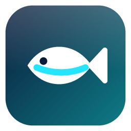
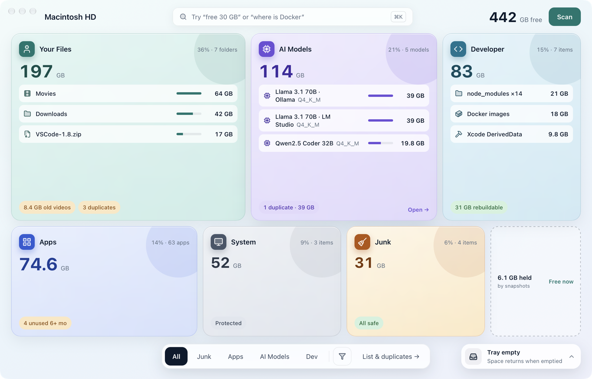
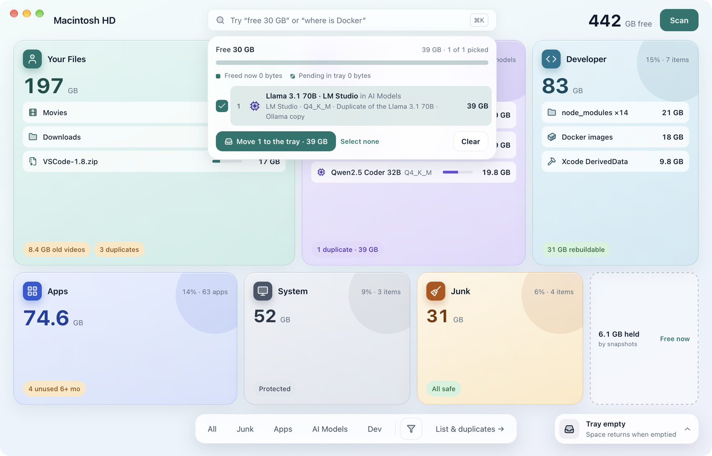
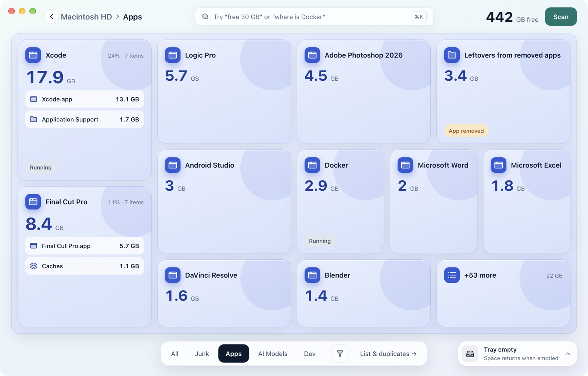
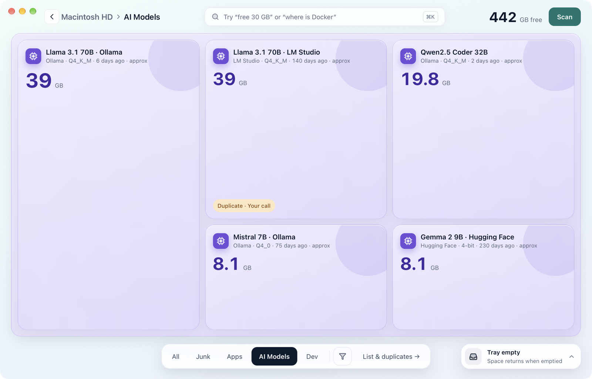
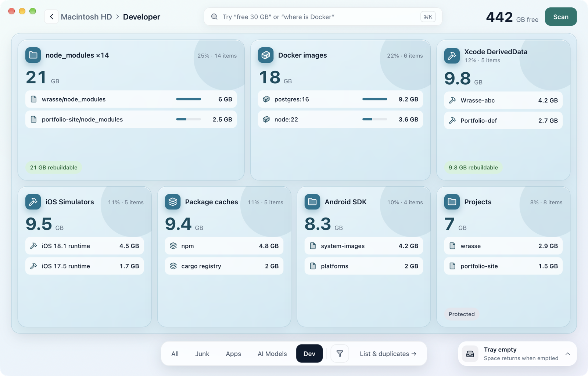
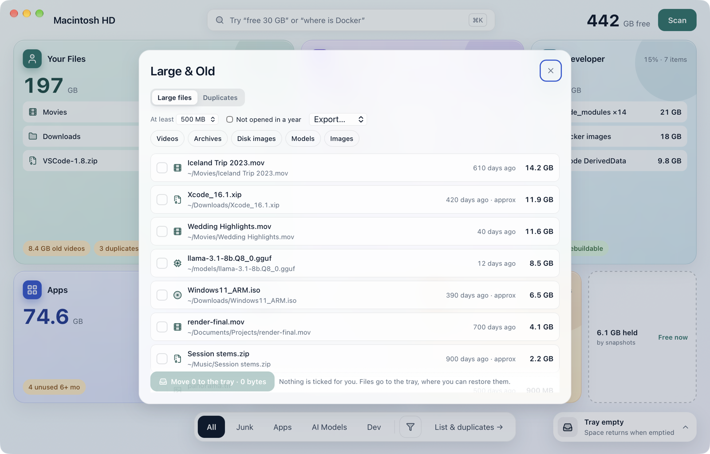

<div align="center">



# Wrasse

**See what fills your Mac, and clear it safely.**

A free, source-available disk cleaner for macOS. Offline, no account, no telemetry.

[](https://github.com/ShanmukYadav/Wrasse/actions/workflows/ci.yml)
[](https://github.com/ShanmukYadav/Wrasse/releases)

[](LICENSE)

[Download](https://github.com/ShanmukYadav/Wrasse/releases) ·
[What it does](#what-it-does) ·
[Install](#install) ·
[Safety](#safety) ·
[Build from source](#build-from-source)



</div>

> **Beta.** Wrasse 0.1.0-beta.1 is macOS only and isn't signed by Apple yet, so macOS asks you to
> confirm the first launch ([see Install](#install)). Windows support comes later.

## What it does

| | |
|---|---|
| **A map of your disk** | Every folder on the Mac, grouped into Your Files, AI Models, Developer, Apps, System and Junk. Each tile says what it is and whether it's safe to clean. Open any tile to go deeper, or switch to a list. |
| **Free Up Space** | Ask for "30 GB" and Wrasse suggests what to remove, best first: caches that rebuild themselves, apps you haven't opened in months, large old files, duplicates. |
| **Apps** | True app sizes, including what each app keeps in `~/Library`. Uninstall an app with its leftovers, and find leftovers from apps you already removed. |
| **AI models** | Local models from Ollama, LM Studio, Hugging Face and others, including duplicate copies of the same model. |
| **Developer junk** | `node_modules`, Xcode DerivedData, simulators, Docker images, package caches, Android SDKs. |
| **Large & Old, duplicates** | The biggest files you haven't opened in a while, and byte-identical copies. |
| **And more** | Startup Items, a menu bar item, export to Markdown, CSV or JSON, keyboard shortcuts, and a space report that explains why free space hasn't come back yet (local snapshots, purgeable space, the Trash). |

## Screenshots

<table>
  <tr>
    <td width="50%"><br><sub><b>Free Up Space</b>: a plan for 30 GB, best first</sub></td>
    <td width="50%"><br><sub><b>Apps</b>: true sizes, leftovers, what's running</sub></td>
  </tr>
  <tr>
    <td><br><sub><b>AI Models</b>: every local model, duplicates marked</sub></td>
    <td><br><sub><b>Developer</b>: build folders, caches, simulators</sub></td>
  </tr>
  <tr>
    <td colspan="2" align="center"><br><sub><b>Large & Old</b>: big files you haven't opened in a while, and duplicates</sub></td>
  </tr>
</table>

<sub>Screenshots show the built-in sample disk, not a real Mac.</sub>

## Install

1. Download `Wrasse_0.1.0-beta.1_universal.dmg` from the
   [latest release](https://github.com/ShanmukYadav/Wrasse/releases), open it and drag Wrasse to
   Applications. One download runs on both Apple Silicon and Intel Macs.
2. Open Wrasse. Because this beta isn't signed by Apple, macOS says it can't verify it. Click
   **Done** (not Move to Trash).
3. Open **System Settings › Privacy & Security**, scroll to Security, and click **Open Anyway**
   next to "Wrasse was blocked". Confirm with your password or Touch ID. You only do this once.
4. **Full Disk Access** (recommended): Wrasse's first screen has a button that opens System
   Settings › Privacy & Security › Full Disk Access; turn Wrasse on there. Without it Wrasse still
   works, but some folders (Mail, Safari, other apps' data) show as unreadable.

## Safety

- **A tray before anything is deleted.** What you remove goes to the tray first and can be put back
  for 7 days (1–30, your choice).
- **Re-checked at the last moment.** Wrasse checks every item again right before it acts, and
  anything that can't be undone says so before you confirm.
- **Never touched:** macOS itself and other protected system places, your Keychains, the Photos and
  Music libraries, anything on your Never touch list, and iCloud files that aren't downloaded.
- **Your documents are yours to pick.** Documents, Desktop and iCloud Drive are never suggested: you
  choose from them by hand, and they always go to the tray.
- **Everything is listed.** Every place Wrasse protects and every program it may run is in
  [docs/security-audit.md](docs/security-audit.md), and a check keeps that list in sync with the
  code.

## Privacy

No telemetry, no analytics, no account. Wrasse's only network use is the update check, **off until
you turn it on** in Settings, and local calls to Ollama on your own Mac (`127.0.0.1`) when you use
AI models. Updates are signed, and Wrasse only installs updates signed with the project's key.

## Uninstall Wrasse completely

1. In Wrasse: **Settings › Remove all Wrasse data** (the tray, saved scans, logs, settings). It
   shows what will go first.
2. If you turned on **Open at login**, turn it off in Settings.
3. Quit Wrasse (menu bar item › Quit Wrasse) and move it from Applications to the Trash.
4. Nothing else remains. To check: `~/Library/Application Support/com.shanmukyadav.wrasse` should
   be gone.

## Build from source

Wrasse is a Rust core with a [Tauri 2](https://tauri.app) app (React and TypeScript) and a
command-line tool. The project is self-contained: Rust and Node live in `.toolchain/`, and every
command runs through `./dev.sh`, so nothing is installed globally.

```sh
git clone https://github.com/ShanmukYadav/Wrasse.git && cd Wrasse

# One-time setup on macOS (installs into ./.toolchain only)
mkdir -p .toolchain/node
curl -fsSL https://nodejs.org/dist/v24.21.0/node-v24.21.0-darwin-arm64.tar.gz \
  | tar -xz -C .toolchain/node --strip-components=1
curl -fsSL https://sh.rustup.rs | ./dev.sh sh -s -- -y --no-modify-path --profile minimal

# Run the app
cd app
../dev.sh npm install
../dev.sh npm run tauri dev
```

On an Intel Mac, use the `darwin-x64` Node archive. The browser preview
(`cd app && ../dev.sh npm run dev`) runs on sample data.

### Project layout

```
app/                 the macOS app: React UI (src/) and Tauri shell (src-tauri/)
crates/wrasse-core   scanning, rules, cleanup, the tray; everything that touches the disk
crates/wrasse-cli    command-line wrapper over the core
crates/wrasse-fixtures  fake homes and dummy apps for tests
rules/               junk rule packs (TOML)
scripts/             checks, budgets and helper scripts
docs/                architecture, security audit, release and test guides
```

More in [docs/architecture.md](docs/architecture.md).

## Contributing

Issues and pull requests are welcome. Read [CONTRIBUTING.md](CONTRIBUTING.md) first: it has the
safety rules, the checks to run, and how to test without touching real files.

- Something wrong or missing: [open an issue](https://github.com/ShanmukYadav/Wrasse/issues/new/choose).
- **Wrasse removed something it shouldn't have:** look in the tray first (bottom right; Restore
  puts it back), then use that issue template.
- Security vulnerabilities: report them privately, see [SECURITY.md](SECURITY.md).

## License

Copyright © 2026 Shanmuk kukati. Wrasse is source-available under the
[PolyForm Noncommercial License 1.0.0](LICENSE): you may use, study and change it for
noncommercial purposes (personal use, research, education, charities and similar). **Commercial
use is not allowed** without written permission from the author. The Wrasse name and fish mark are
not licensed: see [docs/trademark.md](docs/trademark.md). Release notes are in
[CHANGELOG.md](CHANGELOG.md).
